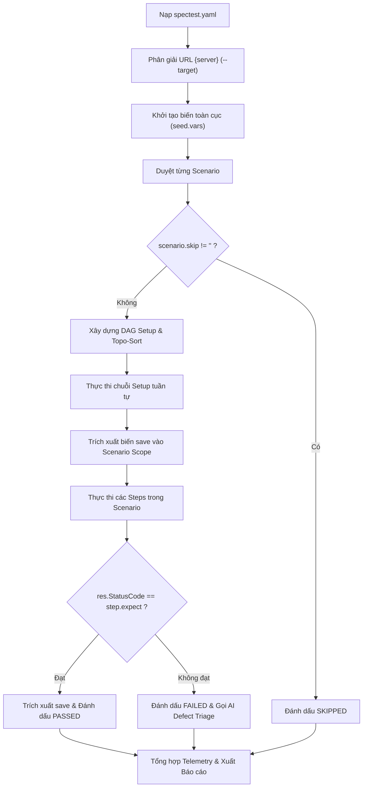

# SPECTEST-AI: BẢN ĐẶC TẢ KIẾN TRÚC & HỆ THỐNG TOÀN DIỆN (SYSTEM MASTER CONTEXT)
> **Tài liệu ngữ cảnh hoàn chỉnh dành cho AI Coding Assistant & Developer Core Team**  
> **Dự án:** SpecTest-AI (Autonomous AI Test Engineering Engine & CLI / Web Control Center)  
> **Phiên bản kiến trúc:** v2.0 (Mô hình 2 File chuẩn: `spectest.yaml` + `spectest.log.yaml`)  
> **Tiêu chuẩn cuộc thi:** Giải pháp phần mềm – Bảng 3: Phát triển ứng dụng nguồn mở (PMNM)

---

## 1. TỔNG QUAN & TRIẾT LÝ THIẾT KẾ CỐT LÕI

### 1.1. Mục tiêu sản phẩm
SpecTest-AI chuyển đổi các thông số kỹ thuật (OpenAPI 3.x) và tài liệu yêu cầu nghiệp vụ thô (Markdown PRD) thành kịch bản kiểm thử API hoàn chỉnh, tự động thực thi với khả năng truyền trạng thái đa tầng (State Chaining), và tự động tiến hóa kịch bản kiểm thử khi đặc tả thay đổi theo thời gian.

### 1.2. Mô hình 2 File chuẩn (Two-File Architecture)
Theo quyết định kiến trúc chính thức, hệ thống quản lý kiểm thử thông qua đúng **2 file** duy nhất trong thư mục đầu ra:

| Tên file | Vai trò | Chế độ ghi | Mục đích |
| :--- | :--- | :--- | :--- |
| `spectest.yaml` | **Current Suite State** | Ghi đè (Overwrite) | Trạng thái hiện tại của bộ test suite. Runner (`spectest run`) và Web UI đọc trực tiếp file này để thực thi. |
| `spectest.log.yaml` | **Audit History Log** | Chỉ thêm (Append-only) | Lưu trữ bản snapshot ban đầu (`base`) và toàn bộ các lần tiến hóa (`update[]`), bảo toàn vết thay đổi theo thời gian. |

> [!IMPORTANT]
> **Loại bỏ hoàn toàn file thứ 3 (`spectest.track.yaml`)**. Không lưu trữ fingerprint riêng biệt. Mọi so khớp và quản lý suite đều dựa trên cấu trúc 2 file `spectest.yaml` và `spectest.log.yaml`.

---

## 2. ĐẶC TẢ SCHEMA `spectest.yaml` (VERSION 1)

`spectest.yaml` đại diện cho bộ kiểm thử hoàn chỉnh tại một thời điểm, được chuẩn hóa theo định dạng v1.

### 2.1. Cấu trúc tổng thể
```yaml
version: 1
servers: [auth, order]

apis:
  - POST {auth}/api/register
  - POST {auth}/api/login
  - POST {order}/api/products
  - POST {order}/api/orders

analysis: |
  - Có register + login nên tạo được user mới cho từng scenario độc lập.
  - Requirements có sẵn tài khoản admin dùng tạo product catalog.

seed:
  admin:
    vars:
      admin_email: admin@shop.com
      admin_password: Admin@123

setup:
  admin_session:
    vars:
      email: "{{admin_email}}"
      password: "{{admin_password}}"
    steps:
      - call: POST {auth}/api/login
        body: {email: "{{email}}", password: "{{password}}"}
        expect: 200
        save: {admin_token: body.access_token}

  user:
    vars:
      email: "user_{{random}}@test.com"
      password: "P@ssw0rd123"
    steps:
      - call: POST {auth}/api/register
        body: {email: "{{email}}", password: "{{password}}"}
        expect: 201
        save: {user_id: body.id}

  logged_in_user:
    use: [user]
    steps:
      - call: POST {auth}/api/login
        body: {email: "{{email}}", password: "{{password}}"}
        expect: 200
        save: {user_token: body.access_token}

  product:
    use: [admin_session]
    steps:
      - call: POST {order}/api/products
        headers: {Authorization: "Bearer {{admin_token}}"}
        body: {name: "product_{{random}}", price: 100}
        expect: 201
        save: {product_id: body.id}

scenarios:
  - id: login-wrong-password
    name: Login sai password
    setup: [user]
    steps:
      - call: POST {auth}/api/login
        body: {email: "{{email}}", password: "sai_mat_khau"}
        expect: 401

  - id: order-over-stock
    name: Đặt hàng vượt tồn kho
    setup: [logged_in_user, product]
    steps:
      - call: POST {order}/api/orders
        headers: {Authorization: "Bearer {{user_token}}"}
        body: {items: [{product_id: "{{product_id}}", quantity: 6}]}
        expect: 422
```

### 2.2. Chi tiết các trường dữ liệu
- **`version` (int):** Luôn là `1`.
- **`servers` ([]string):** Danh sách tên định danh máy chủ (ví dụ `[auth, order]`), runner sẽ phân giải thành Base URL tương ứng.
- **`apis` ([]string):** Danh sách API hoạt động trong hệ thống theo định dạng `METHOD {server}PATH`.
- **`analysis` (string):** Đoạn tổng hợp phân tích của AI về logic nghiệp vụ, luồng xác thực và chiến lược kiểm thử.
- **`seed` (map[string]Seed):** Tập biến khởi tạo mặc định toàn cục (`vars`). Cấm trùng tên biến giữa các seed khác nhau.
- **`setup` (map[string]Setup):** Các khối chuẩn bị dữ liệu tiền điều kiện:
  - `use` ([]string): Danh sách các khối setup phụ thuộc (phải chạy trước).
  - `vars` (map[string]any): Biến cục bộ, hỗ trợ tham chiếu seed var và token sinh ngẫu nhiên `{{random}}`.
  - `steps` ([]Step): Danh sách bước HTTP thực thi để sinh trạng thái/dữ liệu.
- **`scenarios` ([]Scenario):** Các kịch bản kiểm thử hành vi nghiệp vụ:
  - `id` (string): Định danh duy nhất kebab-case (ví dụ: `order-over-stock`).
  - `name` (string): Tên mô tả ngữ nghĩa kịch bản.
  - `setup` ([]string): Danh sách khối setup trực tiếp cần thiết cho kịch bản.
  - `steps` ([]Step): Chuỗi các bước HTTP thực thi tuần tự.
  - `skip` (string, optional): Lý do bỏ qua kịch bản; nếu có giá trị, runner sẽ skip kịch bản này.
  - `locked` (bool, optional): Cờ khóa, ngăn chặn AI tự ý sửa hoặc xóa kịch bản này trong các lần cập nhật.

### 2.3. Cấu trúc một bước kiểm thử (Step Schema)
Mỗi `Step` là một thao tác HTTP đơn nhất, tinh gọn và rõ ràng:
```yaml
- call: POST {auth}/api/login
  headers:
    Authorization: "Bearer {{user_token}}"
  body:
    email: "{{email}}"
    password: "{{password}}"
  expect: 200
  save:
    user_token: body.access_token
```
- **`call` (string, bắt buộc):** Định dạng `<METHOD> {<server>}<path>[?<query>]`. Method viết in hoa. Cả path và query string có thể chứa biến `{{var}}`.
- **`headers` (map[string]string, tùy chọn):** Các HTTP request header, hỗ trợ nội suy `{{var}}`. Tự động thêm `Content-Type: application/json` nếu có `body`.
- **`body` (any, tùy chọn):** Dữ liệu payload gửi kèm (Object/Array/Scalar). Nếu giá trị chuỗi đúng bằng `"{{var}}"`, kiểu dữ liệu gốc của biến (số, boolean, mảng, map) được bảo toàn nguyên vẹn.
- **`expect` (int, bắt buộc):** Mã trạng thái HTTP mong đợi (ví dụ: `200`, `201`, `401`, `422`).
- **`save` (map[string]string, tùy chọn):** Ánh xạ trích xuất giá trị vào biến runtime cho các bước sau:
  - `body.<dot-path>`: Trích xuất từ JSON response body (ví dụ `body.access_token`, `body.data.id`, `body.items.0.id`).
  - `header.<name>`: Trích xuất từ HTTP response header (ví dụ `header.Authorization`).

---

## 3. ĐẶC TẢ SCHEMA `spectest.log.yaml`

File `spectest.log.yaml` ghi lại toàn bộ lịch sử tiến hóa theo nguyên lý Event Sourcing (Append-Only):

```yaml
base:
  at: 2026-10-20T09:00:00+07:00
  by: ai
  spectest:
    # Bản snapshot nguyên văn của suite lúc sinh lần đầu
  after_hash: 5c1d02a9b7e4

update:
  - n: 1
    at: 2026-10-24T10:15:00+07:00
    by: ai
    note: "API added: POST {order}/api/orders/{id}/cancel"
    trigger:
      openapi:
        added: ["POST {order}/api/orders/{id}/cancel"]
        changed: ["POST {auth}/api/register"]
        removed: []
      requirements:
        before_hash: a1b2c3d4e5f6
        after_hash: f6e5d4c3b2a1
    create:
      setup:
        order:
          use: [logged_in_user, product]
          steps:
            - call: POST {order}/api/orders
              headers: {Authorization: "Bearer {{user_token}}"}
              body: {items: [{product_id: "{{product_id}}", quantity: 1}]}
              expect: 201
              save: {order_id: body.id}
      scenarios:
        - id: order-cancel-pending
          name: Hủy đơn đang pending
          setup: [order]
          steps:
            - call: POST {order}/api/orders/{{order_id}}/cancel
              headers: {Authorization: "Bearer {{user_token}}"}
              expect: 200
    change:
      - target: setup
        id: user
        reason: "register bổ sung field phone bắt buộc"
        before:
          vars: {email: "user_{{random}}@test.com", password: "P@ssw0rd123"}
        after:
          vars: {email: "user_{{random}}@test.com", password: "P@ssw0rd123", phone: "0912345678"}
      - target: analysis
        reason: "ghi nhận API hủy đơn mới"
        before: ...
        after: ...
    after_hash: 8e41ab77c9d0
```

### 3.1. Thuật toán Canonical SuiteHash
- Sử dụng **SHA-256**, mã hóa hex, lấy **12 ký tự đầu**.
- Canonical hash tính trên JSON của 4 block chính: `{analysis, seed, setup, scenarios}` (không gồm `version`, `servers`, `apis`).
- **Chuẩn hóa trước khi hash:**
  - `analysis`: Chuẩn hóa xuống LF (`\n`), trim khoảng trắng cuối dòng, có newline ở cuối.
  - `seed`/`setup`: Sắp xếp tăng dần theo tên key.
  - `use` và `setup` trong scenario: Sắp xếp danh sách tên phụ thuộc theo alphabet.
  - `scenarios`: Sắp xếp danh sách kịch bản theo `id`.
  - `steps`: Giữ nguyên thứ tự thực thi (có ý nghĩa ngữ cảnh).
  - Bỏ qua các trường mặc định (`locked: false`, `skip: ""`, map/slice rỗng).

---

## 4. CƠ CHẾ THỰC THI KIỂM THỬ (`spectest run`)

Lệnh `spectest run` chịu trách nhiệm nạp kịch bản, điều phối đồ thị phụ thuộc, gửi request HTTP, kiểm thử oracle và báo cáo kết quả.



### 4.1. Phân giải địa chỉ máy chủ (`{server}`)
- Suite chỉ định nghĩa server alias (ví dụ `servers: [auth, order]`).
- Runner nhận base URL qua flag CLI:
  - Cấu hình chung cho mọi server: `-t http://localhost:8080`
  - Cấu hình riêng lẻ từng service: `--target auth=http://localhost:8001 --target order=http://localhost:8002`

### 4.2. Điều phối đồ thị phụ thuộc (DAG & Topo-Sort)
- Mỗi scenario khai báo `setup: [...]`. Mỗi setup khai báo `use: [...]`.
- Runner tính toán đóng bao bắc cầu (Transitive Closure), phát hiện chu trình phụ thuộc (Cycle Detection báo lỗi), và sắp xếp topo để các setup gốc chạy trước.
- **Tính cô lập (Per-Scenario Isolation):** Mỗi scenario sở hữu scope biến riêng biệt, chạy chuỗi setup độc lập để tránh ảnh hưởng dữ liệu giữa các bài test.

### 4.3. Nội suy biến và trích xuất dữ liệu (`save`)
- **Nội suy (Variable Interpolation):**
  - Hỗ trợ `{{var}}` kế thừa từ `seed.vars`, `setup.vars`, và các biến `save` sinh ra trước đó.
  - Hỗ trợ `{{random}}` sinh chuỗi định danh ngẫu nhiên cho mỗi bước.
- **Trích xuất (`save`):**
  - `body.<path>`: Trích xuất an toàn từ JSON response (hỗ trợ nested object và array index: `body.items.0.id`).
  - `header.<name>`: Trích xuất từ HTTP header trả về.

### 4.4. Đánh giá Oracle & Chẩn đoán lỗi AI
- So khớp mã HTTP trả về với `step.expect`.
- Nếu không khớp, ghi nhận lỗi rõ ràng: `expected HTTP status 200, got 401`.
- Nếu có cấu hình LLM Service, tự động kích hoạt **AI Defect Triage** để phân tích nguyên nhân lỗi (sai token, thiếu quyền, payload không hợp lệ) và đưa vào báo cáo.

---

## 5. KIẾN TRÚC MÃ NGUỒN (CLEAN ARCHITECTURE)

Dự án tuân thủ nghiêm ngặt nguyên lý Clean Architecture:

```
spectest/
├── cmd/spectest/                  # Entrypoint chính của ứng dụng CLI
│   └── main.go
├── internal/
│   ├── domain/                    # Thực thể và Ports thuần túy (Không phụ thuộc bên ngoài)
│   │   ├── suite.go               # Domain Suite, Seed, Setup, Scenario, Step
│   │   ├── history.go             # Domain LogFile, BaseEntry, UpdateEntry, Change
│   │   ├── ports.go               # Interfaces: SuiteRepository, LLMService, ServerLifecycleManager
│   │   └── legacy.go              # Lớp tương thích tạm thời cho bộ generator cũ
│   ├── usecase/                   # Tầng điều phối nghiệp vụ ứng dụng
│   │   ├── run/                   # Động cơ thực thi kịch bản kiểm thử
│   │   │   ├── runner.go          # Điều phối chạy suite, tổng hợp telemetry
│   │   │   ├── dag.go             # Thuật toán Topo-Sort & Cycle Detection cho Setup
│   │   │   └── scope.go           # Quản lý scope, nội suy {{var}} và trích xuất save
│   │   └── generate/              # Pipeline sinh kịch bản từ OpenAPI/PRD
│   ├── infrastructure/            # Tầng hạ tầng và giao tiếp dịch vụ ngoài
│   │   ├── storage/               # Lưu trữ file YAML (spectest.yaml, spectest.log.yaml, SuiteHash)
│   │   ├── llm/                   # Client giao tiếp LLM (Gemini, OpenAI, Local OpenAI-compatible)
│   │   └── server/                # Kiểm tra readiness HTTP & điều phối Docker Compose
│   └── adapter/                   # Tầng giao diện người dùng và điều hợp
│       ├── cli/                   # Giao diện dòng lệnh Cobra (generate, run, config, ui)
│       └── ui/                    # Web UI Server & SSE Realtime Streaming Runner
└── tests/                         # Thư mục chứa kịch bản kiểm thử
```

---

## 6. QUY TẮC PHÁT TRIỂN & CHUẨN MÃ NGUỒN (WORKING RULES)

1. **Ngôn ngữ & Tài liệu:** Toàn bộ source code, comment, docstring, commit message sử dụng 100% tiếng Anh kỹ thuật chuẩn mực. Giao tiếp với người dùng bằng tiếng Việt rõ ràng, súc tích.
2. **Clean Architecture:** Domain không bao giờ import Infrastructure. Usecase chỉ phụ thuộc vào Domain và Ports.
3. **Chất lượng kiểm thử:** Duy trì kiểm thử không có điều kiện tương tranh (`go test -race ./...`) và linter sạch sẽ (`golangci-lint run`).
4. **Không tùy tiện sửa đổi:** Giữ nguyên các comment và tài liệu không liên quan đến phạm vi thay đổi.
